# Project flow documentation

How the platform works, one process at a time, and how the processes feed each other.
Everything here was read from the code. File paths are relative to the repo root. Where something could not be confirmed it says **verify**.

Conventions: the API prefix is `/api/v1`. "Project" and "business" are the same thing (table `businesses`, model `Business`).

---

## 0. System map

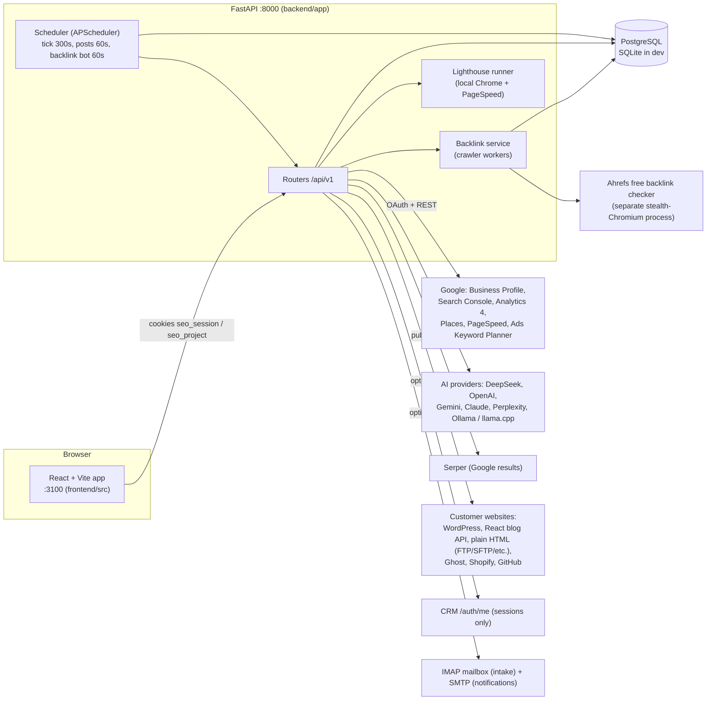

- **Entry point:** `backend/app/main.py` builds the app, registers every router under `/api/v1`, starts the scheduler and the backlink service in its `lifespan`, and in production serves `frontend/dist` from the same address.
- **Start-up** (`lifespan`): sync the schema (section 19), seed the admin user, back-fill project owners, recover Lighthouse/background runs that died with the last process, start the scheduler.
- **Frontend:** routes are declared in `frontend/src/App.jsx`; the sidebar is `frontend/src/components/sidebarGroups.js`; every data page uses `SeoShell` (`frontend/src/platform/SeoUi.jsx`) which owns the selected project; API calls go through `api()` / `useApi()` in `frontend/src/platform/seoApi.js`.

---

## 1. Authentication and sessions

**Purpose:** decide who is calling and what they may do.
**Files:** `backend/app/auth.py`, `backend/app/routers/auth.py`, `backend/app/services/totp.py`, `frontend/src/platform/ProjectCodeModal.jsx`, `projectCode.js`.

Two kinds of sessions are accepted by `current_user` (`auth.py`):

| Kind | Cookie / header | Who | Notes |
|---|---|---|---|
| Platform user | cookie `seo_session` (JWT, `kind=seo`, 12 h) or `Authorization: Bearer` | rows in `users` (`AppUser`) | email + password |
| CRM user | cookie `crm_session` (JWT signed with `CRM_JWT_SECRET`) | users of the sister CRM | role/department read from the CRM's `/auth/me`, cached 5 min; allowed only if role or department is in `ALLOWED_ROLES` / `ALLOWED_DEPARTMENTS` |

**Roles** (`AppUser.role`): `admin`, `editor`, `viewer`.
- A viewer can read everything but every non-GET is refused with 403, except the read-only POSTs listed in `READ_ONLY_POSTS` (assistant, discover, keyword overview, logout, change-password).
- `User.sees_all` = admin, or a CRM session with no role. These see every project. Everyone else sees only their own (section 2).

**Endpoints** (`routers/auth.py`)

| Endpoint | What it does |
|---|---|
| `POST /auth/login` | checks password, sets `seo_session`. 5 wrong tries (`LOGIN_MAX_FAILURES`) lock the account for 15 min (`LOGIN_LOCKOUT_MINUTES`) |
| `POST /auth/forgot-password` | emails a reset link / token (JWT `kind=password_reset`, valid 1 h) through SMTP |
| `POST /auth/reset-password`, `POST /auth/change-password`, `POST /auth/logout` | |
| `GET/POST /users`, `PATCH /users/{id}` | admin only: create users, change role/active/password, `reset_2fa` |
| `GET /me` | the user, `totp_enabled`, `can_enrol_2fa` |

**First start:** `seed_admin` creates the admin from `ADMIN_EMAIL` / `ADMIN_PASSWORD` when there are no users.

### Two-step code when switching project (TOTP)

**Trigger:** a user with two-step turned on opens a project other than the last verified one.

```mermaid
sequenceDiagram
  participant U as User
  participant FE as Frontend (choose / api)
  participant API as Backend
  U->>FE: switch project
  FE->>U: ProjectCodeModal (6-digit code; first-time setup wizard if not enrolled)
  U->>FE: code
  FE->>API: POST /auth/switch-project {business_id, code}
  API-->>FE: sets httpOnly cookie seo_project (JWT, 8 h, one project)
  FE->>API: normal project calls
  Note over API: get_business / owned_business: if user has 2FA and cookie project != id -> 403 {code: project_code_required}
  API-->>FE: (fallback) 403 -> seoApi.js opens the modal, then retries the call once
```

- Endpoints: `POST /auth/2fa/setup` (key + `otpauth://` + QR as SVG), `POST /auth/2fa/enable`, `POST /auth/2fa/disable` (code + password), `POST /auth/switch-project`.
- TOTP is RFC 6238 (SHA-1, 30 s, 6 digits, ±1 step) in `services/totp.py`. A code works once (`AppUser.totp_last_step`). The secret is stored sealed (`services/crypto.py`). Wrong codes count toward the same lockout as passwords.
- A new switch replaces the previous `seo_project` claim, so each switch needs a fresh code. Admins are included.
- Not enforced for CRM sessions (they cannot enrol), and only for users who turned two-step on. The UI asks multi-project users to enrol when they first switch.
- Lost phone: an admin sends `PATCH /users/{id} {"reset_2fa": true}`.

**Feeds:** everything below. Every project endpoint depends on `current_user`.

---

## 2. Project ownership and access

**Purpose:** a user only ever sees their own projects (plus those they manage). **Files:** `backend/app/deps.py`, `backend/app/conn_access.py`, `backend/app/models.py` (`Business.owner_id`, `BusinessManager`).

Rules (`deps.py`):
- `Business.owner_id` = the creating user's id (`"1"`, or `"crm:48"`). Projects that existed before this was added were assigned to the first active admin at start-up (`backfill_owners`).
- `can_access(user, b)` is true when: the user `sees_all`, or owns it, **or their sign-in email has manager access**: the email of the Google account linked to the project, the project's `contact_email`, or an email in `business_managers`.
- `get_business` / `owned_business` return **404** (not 403) for a project the user may not open, so existence is not leaked. They also apply the two-step rule from section 1.
- List and dashboard endpoints use `only_mine(stmt, user)` or `my_business_ids(db, user)` (returns `None` for admins) to filter: `/businesses`, `/businesses/portfolio`, `/analytics`, `/site-audit`, `/rank-tracking`, `/businesses/services`, copilot, workplan overview, website audits, competitor audit history, lighthouse history.
- Google connections: `conn_access.owns_connection` – the account that connected it (`connected_by = "user <id>"`), an admin, or a user whose email equals the connection's email. A project's explicitly linked connection stays usable by anyone who can open the project.

Endpoints: `PUT /businesses/{id}/owner` (admin: hand a project to someone), `GET/PUT /businesses/{id}/managers` (owner or admin edits the list; the contact email and the linked Google account email always have access), `DELETE /businesses/{id}` (owner or admin).

Not covered (see section 19): the backlink service's shared domain store, intake emails that are not yet a project, Lighthouse rows (scoped by website host).

---

## 3. Onboarding (`/onboarding`)

**Purpose:** create a project with everything the agents need. **Files:** `frontend/src/platform/BusinessOnboardingPage.jsx`, `backend/app/routers/discover.py`, `services/discovery.py`, `services/site_onboarding.py`.

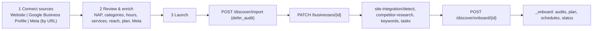

**Step 1 – three independent source cards.** Nothing from one card pre-fills another; the sources are merged only on Continue (the typed website always wins). A project needs the Website or the Google profile.
- *Website:* validate; "Detect details" → `POST /discover` in website mode (reads schema.org, tel links, address, social links; `services/discovery.py`).
- *Google Business Profile:* search → `GET /discover/suggest`, `POST /discover/resolve`; Places API when `GOOGLE_PLACES_API_KEY` is set.
- *Meta Business Suite:* Facebook page URL, Instagram handle, Meta Business ID, saved as `Business.social_accounts`. **No Meta login exists**; nothing is fetched from Meta.
- Other helper endpoints: `/discover/countries`, `/geocode`, `/areas`, `/reverse`, `/assist`.

**Step 2 – review.** Required: name, website (not if a Google listing is linked), primary category, phone, contact email, city, country, at least one service. Also target scope (local / national / international), plan, keywords, hours, Meta fields.

**Step 3 – launch** (`LaunchStep`):
1. `POST /discover/import` with `defer_audit: true`: finds an existing project of this user (same Place ID, phone or website) or creates one with `owner_id = user.id`, copies the candidate's fields into empty columns, pulls up to 5 public Google reviews and the photo count.
2. `PATCH /businesses/{id}` saves the rest, including `social_accounts`.
3. Website research: `POST /businesses/{id}/site-integration/detect`; competitor research: `POST /businesses/{id}/competitor-research`; keywords: `POST /businesses/{id}/keywords`; follow-up tasks: `POST /businesses/{id}/tasks`.
4. `POST /discover/onboard/{id}` starts the background run `_onboard`: all six audits (`audits.run_all`), the AI agent plan (`agent.plan_from_audits`), the plan's schedule rows (`schedules.create_for_plan`), then sets `status` to `needs_approval` (tasks wait for a person) or `active`. It also switches on backlink discovery (`backlinks/autostart.enable`) and starts the Seed Backlink Finder (`backlink_service/trigger`).
5. `POST /businesses` (manual create) additionally runs `site_onboarding` (tech stack, metadata, improvements) and `workplan.start_in_background` when `SITE_AUTODETECT` is on.

Other ways in: forward an onboarding email to the mailbox (section 14), or import a Google location (section 5).

**Feeds:** audits (8), schedules (15), backlinks (11), work plan (13), site integration (12).

---

## 4. Projects page (`/projects`)

**Purpose:** see every project, which services it has, remove one service, delete a project. **Files:** `frontend/src/platform/ProjectsPage.jsx`, `backend/app/services/project_services.py`, `routers/businesses.py`.

- **Services** are `Business.modules`, a subset of `seo, geo, aeo, gmb`. `NULL` means "not chosen": SEO, GEO and AEO on; GMB on when a Google profile or connection exists.
- `GET /businesses/services` – one row per visible project with services and stored-data counts.
- `PUT /businesses/{id}/services/{module}` – turn a service back on (restores schedules, not data).
- `DELETE /businesses/{id}/services/{module}` – removes one service and only its data:

| Service | Deleted | Also |
|---|---|---|
| SEO | audits, keywords, rank scans, rank history, SEO schedules | resets the health score |
| GMB | reviews, posts, customer-action history | unlinks the Google profile here (nothing changes on Google) |
| GEO / AEO | that group's `geo_results` | prompts are deleted only when both are removed |

- **GEO vs AEO split:** one dataset (`geo_prompts`, `geo_results`) split by engine. GEO = ChatGPT, Gemini, Claude, DeepSeek. AEO = Perplexity and any other engine.
- `scheduler` and `schedules.run_job` skip jobs of a removed service (`project_services.job_enabled`).
- `DELETE /businesses/{id}` – owner or admin. Deletes the project and everything keyed to it: database foreign keys cascade, and website scans with `workspace_id` are removed explicitly. Google itself is never touched. Frontend uses the two-step `useDoubleConfirm`.
- Opening a project from this page goes through the two-step code (section 1).

---

## 5. Google connections

**Purpose:** let the platform read (and, after approval, write) Google data for a project. **Files:** `routers/connections.py`, `services/gbp.py`, `services/gsc.py`, `services/ga4.py`, `frontend/src/platform/ConnectionsPage.jsx`, `GbpAccounts.jsx`.

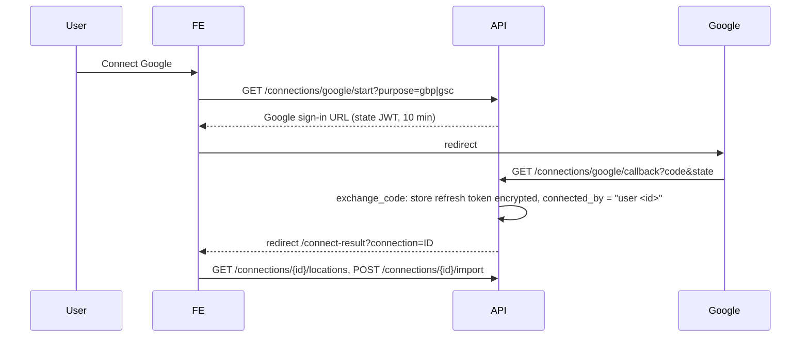

- **Scopes:** Business Profile `business.manage` (a GBP sign-in also asks for Search Console `webmasters.readonly`); Analytics `analytics.readonly`, requested separately by `GET /analytics/ga4/start` and merged into the same connection by the same callback.
- **Tokens:** refresh token sealed with `TOKEN_ENCRYPTION_KEY` (`services/crypto.py`). Needs `GOOGLE_CLIENT_ID` / `GOOGLE_CLIENT_SECRET`.
- **Endpoints:** `GET /connections`, `GET /connections/google/setup` (what to configure in Google Cloud), `GET /{id}/locations`, `POST /{id}/import` (creates projects with `owner_id`), `POST /{id}/sync`, `DELETE /{id}`. Only the user's own connections are listed.
- **Linking to a project:** `POST /businesses/{id}/seo/link-account` sets `Business.connection_id`. A project with no link tries `seo._find_owner`, which looks for one of the owner's connections that owns the site's Search Console property.
- A second user connecting the same Google email takes over that connection (existing behaviour, see section 19).

**Feeds:** GMB (6), website traffic (7), SEO data (9).

---

## 6. Google Business Profile (GMB) module

**Purpose:** manage and monitor the Google listing. **Frontend:** `GbpManagerPage.jsx` (tabs: Business Profile, Performance, Reviews & Reputation, Posts & Content, Photos & Media, Local SEO, AEO, GEO, Competitor Analysis, AI Recommendations, Reports, Tasks, Sync History, Settings), `ReviewManagerPage.jsx`, `LocalRankTrackerPage.jsx`.

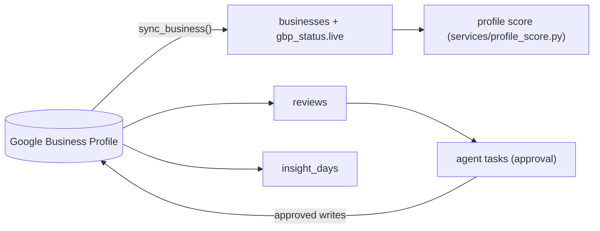

- **Sync** (`gbp.sync_business`, `POST /businesses/{id}/sync`, `POST /maps-refresh`, nightly via the `reviews` job): refreshes status and fields from Google (Google is the source of truth), reviews, photo count, logo/cover, and daily insights (calls, directions, website clicks) into `insight_days`.
- **Read endpoints:** `GET /businesses/{id}/gbp/live`, `/gbp/score`, `/insights` (leads router), `/reviews` (profile router).
- **Edit endpoints** (`routers/gbp_manage.py`): categories, address, attributes, media, posts publish/patch/delete, live post delete, review reply delete. Editing a Google-linked profile pushes to Google first; if Google refuses, nothing is saved here.
- **Content:** `routers/profile.py` – posts (draft with AI), review replies (`/reviews/{id}/draft`, `/approve`), AI description and FAQs.
- **Score:** `services/profile_score.py` gives 0-100 on category, reviews, proximity, website, citations/NAP, activity. The frontend uses the same rules.
- **Writes** only happen from approved agent tasks (section 13).
- **Gating:** GBP data endpoints return 409 until the access checklist is complete (section 7).

**Feeds:** the agent (review replies, weekly post), reports (section 14), local rank tracker, copilot briefing.

---

## 7. Website traffic and the access checklist

**Purpose:** real traffic of the project's own website, shown only once all permissions are in place. **Files:** `frontend/src/platform/TrafficPage.jsx`, `backend/app/routers/ga4_by_email.py`, `routers/analytics_by_email.py`, `services/ga4.py`, `services/gsc.py`, `backend/app/access.py`.

### Access checklist (website + GMB gating)

`GET /businesses/{id}/access-status` (`access.evaluate`, `?refresh=true` skips the cache) returns steps and two flags, `website.complete` and `gmb.complete`.

| Step id | Needed for | OK when |
|---|---|---|
| `website` | website | the project has a website |
| `account` | website, gmb | a Google account the user may use is linked to the project and still connected |
| `scope_analytics` | website | the account granted Analytics read |
| `scope_search_console` | website | the account granted Search Console |
| `scope_business` | gmb | the account granted `business.manage` |
| `ga4_property` | website | a GA4 property for the site's host is visible to the account |
| `search_console` | website | the site is a verified Search Console property |
| `gbp` | gmb | a Business Profile is linked (warns if unverified, pending, suspended, disabled or conflicting) |

Each non-OK step carries a `fix` (grant, link, verify). Google look-ups (GA4 property, Search Console property) are cached 10 min when they succeed and 45 s when they fail.

`access.require(db, user, b, "website"|"gmb")` raises **409 `{code: "access_incomplete", kind, steps}`**, admins included. Gated today: `GET /analytics/ga4/by-email` and `/realtime` (through `access.ga4_properties`), `GET /businesses/{id}/gbp/live`, the sync endpoint in `routers/businesses.py`, `routers/gbp_manage.py` (live data), `routers/leads.py` `/insights`, `routers/profile.py` `/reviews` (Google reviews).
**verify:** the shared frontend checklist component (`AccessGate`) and the final TrafficPage layout were still being built when this was written; confirm they exist in `frontend/src/platform/` and which GMB tabs use them.

### Data flow

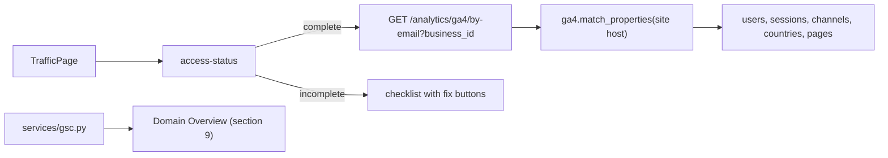

- Inside a project the website and Google account come from the project; the page never reads another project's data. With no project selected the page asks you to add one.
- The question "why does Bing/Google say ownership is lost?" is answered by the `search_console` step: the site must be a **verified** property for the linked account.

---

## 8. Site Audit (`/website-audit`)

**Purpose:** audit the website, read the report, fix and re-check. **Files:** `frontend/src/platform/SiteAuditPage.jsx` (steps `audit` → `report` → `schema`, kept in `?tab=`, always opens on step 1), `WebsiteAuditTool.jsx`, `SiteAuditTable.jsx`, `SiteAuditOverview.jsx`, `SchemaStudio.jsx`; backend `routers/website.py`, `routers/lighthouse.py`, `services/crawler.py`, `services/lighthouse_runner.py`, `services/pagespeed.py`, `services/audit_overview.py`, `services/audits.py`.

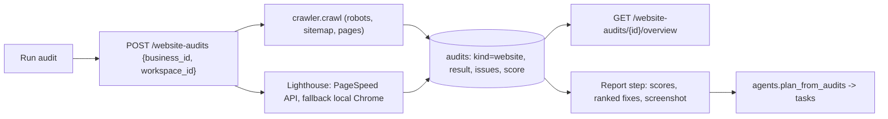

- **Website scans** (`POST /website-audits`, history `GET /website-audits?workspace_id=`, `/overview`, `/{id}`, `/{id}/overview`): need a project (non-admins must name one); scoped to the user's projects.
- **Per-project audits** (`routers/businesses.py`): `POST /businesses/{id}/audits` runs the six kinds `gbp, rankings, technical, onpage, backlinks, citations` (`audits.KINDS`); `GET /audits`, `/audits/{id}`.
- **Site Audit settings:** `GET/PUT /businesses/{id}/audit-config` (pages to crawl up to 300, sitemap/subfolder, subdomains, user agent, allow/disallow, ignore params, schedule off/daily/weekly/monthly, email). A schedule creates/updates the `site_crawl` job.
- **Overview and report:** `GET /businesses/{id}/audit-overview` (health, issues by type, pages to improve, trend, thematic scores) and `/audit-report` (Issues, Crawled Pages, Statistics, Compare Crawls, Progress, JS Impact). `GET /businesses/site-audit` is the table across the user's projects.
- **Lighthouse engine** (`routers/lighthouse.py`): `POST /lighthouse/audits`, `/site-audits`, history, `/{id}/report`, JSON/HTML download. Runs in a pool: PageSpeed Insights (HTTP) with a fallback to local Lighthouse (Node + Chrome, small pool). Every URL passes SSRF checks (`services/url_safety.py`); runs that died with the process are recovered at start-up.
- A completed scan moves the UI to the Report. Re-check = run again; tasks whose issue disappears are closed as "verified" (`agent.reconcile`).
- Switching project or changing the website returns the page to step 1.

**Feeds:** agent tasks and work plan (13), project health on the dashboard and Projects page (4), reports (14), schema generation.

---

## 9. SEO research and tracking

**Frontend:** Position Tracking (`LocalRankTrackerPage`, `PositionTrackingHome`), Keyword Overview / Research (`KeywordResearchPage`, `KeywordOverviewPage`), Domain Overview, Organic Rankings, Top Pages, Keyword Gap, Compare Domains. **Backend:** `routers/growth.py`, `routers/seo.py`, `services/keywords.py`, `organic.py`, `landscape.py`, `rank_report.py`, `top_pages.py`, `google_intel.py`, `keyword_metrics.py`, `providers/`.

| Process | Endpoints | How |
|---|---|---|
| Keywords | `GET/POST /businesses/{id}/keywords`, `PATCH/DELETE /keywords/{id}`, `/keywords/ideas`, `/context`, `/discover`, `/cluster`, `POST /seed-keywords` | discovery from category, services, area, website, competitors; Google Autocomplete (free); volume/CPC from Google Ads Keyword Planner when configured (`GOOGLE_ADS_*`) |
| Local rank scans | `POST/GET /rank-scans` | grid of Maps positions per keyword -> `rank_scans`; used for local projects (`services/market.py`) |
| Organic positions | `POST /seo/check-ranks`, `GET /seo/rank-history`, `/rank-report` | live Google check through Serper (`SERPER_API_KEY`) -> `keywords` + daily `keyword_rank_log` |
| Landscape | `GET /seo/position-landscape` | visibility, movers, distribution computed from `keyword_rank_log` only |
| Targeting | `GET /seo/track-config`, `PUT /seo/track-campaign` | `Business.track_config` (engine, device, location, language) |
| Top pages | `GET /seo/top-pages`, `/top-pages-report` | merges crawl, Google rank, Search Console |
| Domain overview | `GET /seo/domain`, `/domain-intel`, `/organic-research`, `/subdomains` | Search Console of the linked account only; sections Google cannot supply are returned as unavailable, never estimated; cached in `domain_intel_cache` |
| Keyword overview | `POST /seo/keyword-overview` | keyword metrics |
| Cross-project table | `GET /businesses/rank-tracking` | user's projects only |

Rule: results say whether they are `live` or `sample`; the UI labels sample data.

**Feeds:** content ideas (12), work plan items (13), competitor tracking (10), reports (14).

---

## 10. Competitive analysis

**Files:** `competitors/` (`router.py`, `audit_router.py`, `intel_router.py`, `service.py`, `intel.py`, `report.py`), `backlinks/watch.py`; frontend `CompetitorFinderPage`, `CompetitorWatchPage`, `CompareDomainsPage`, `KeywordGapPage`.

- **Finder** (`POST /competitors`, `/competitors/manual`, `GET /competitors?business_id`): Google Places "competitors near a location"; saved competitors live in `competitors` and become backlink-tracked domains.
- **Research** (`GET/POST /businesses/{id}/competitor-research`, `GET /competitor-research/{run_id}`): for the project's keywords, who ranks on Google (organic top 10 and Maps), each competitor's visibility, and what their pages target (`competitors/intel.py`).
- **Competitor audits** (`POST/GET /audit/competitors`, `/compare`, `/{id}`, `/{id}/html`): Lighthouse + on-page crawl of a competitor; stored in `audits` (`competitor_id`).
- **Watch** (`/businesses/{id}/competitor-watch`): weekly revisit of competitor pages, changes stored as `watch_events` and `watch_reports` (`backlinks/watch.py`, run by the backlink tick).
- Ownership: project and competitor ids are checked in the routers; a one-off audit with no project can be read by id by any signed-in user (see section 19).

**Feeds:** keyword gap and compare pages, work plan, backlinks (competitor domains become tracked targets).

---

## 11. Backlinks

Two layers:

1. **Backlink service** (`backend/app/backlink_service/`, endpoints `/backlinks`, `/backlinks/crawl`, `/seeds`, `/backlinks/ahrefs`, `/backlinks/href`): a shared, domain-keyed crawl graph (`bl_*` tables: seeds, targets, backlinks, slots, Ahrefs reports). Started inside the web process by `lifecycle.py`. `business_sync.py` makes every non-paused project's website a target; `trigger.start_for_website` runs at onboarding. `ahrefs.py` stores the Ahrefs free backlink checker's report (run by a separate stealth-Chromium process).
2. **Backlink Intelligence** (`backend/app/backlinks/`, endpoints `/businesses/{id}/backlink-intel/*`): per-project view and the autonomous bot.
   - `autostart.enable` at onboarding: project site and saved competitors become `bi_tracked_targets`, the bot is switched on, first run starts.
   - `bot.py` / `rotation.py`: businesses take turns in batches (`BACKLINK_BATCH_SIZE`, `BACKLINK_BATCH_MINUTES`); the bot follows public links within a page/time/hop budget, obeys robots.txt, and records links to tracked domains (`backlinks`, `backlink_observations`, `backlink_events`).
   - `quality.py` scores relevance and spam risk; `insights.py` (AI, with rule fallback) says which competitor-linking sites are worth pursuing; `outreach.py` drafts a link-removal request (a person sends it); `finder.py` records links to any exact target; `lookup.py` searches stored links (`GET /backlink-intel/lookup`, filtered to the user's projects' domains for non-admins).
   - `outcomes.py` (`/businesses/{id}/outcomes`): snapshot key numbers when an action happens and again after 14 and 30 days.
   - Endpoints: targets, summary, overview, domain-overview, anchors, referring-domains, gap, scores/run, gap/prioritize, explain, disavow, reviews, verify, crawl/seed|run|status, bot get/put/run.

Both layers are started by `scheduler.start()` (`bot_tick` every 60 s when `BACKLINK_BOT_AUTO_ENABLED`) and `backlink_service.start()`.

**Feeds:** backlink audit kind (8), competitor watch (10), tasks (outreach), reports.

---

## 12. AEO / GEO and AI content

### AEO / GEO (AI search visibility)
**Files:** `services/geo.py`, `routers/growth.py`, `GeoTrackerPage.jsx`, `AiQuestionsPage.jsx`.
- `POST /businesses/{id}/geo/prompts` adds a customer question; `POST /geo/run` (and the weekly `geo` job) asks each configured engine (OpenAI-compatible: OpenAI, Gemini, DeepSeek, Perplexity, plus Anthropic) and checks the answer for the business name, list position, cited URLs and competitors. Stored in `geo_prompts` / `geo_results`. Engines without a key are skipped; with none, labelled sample data is stored. API answers can differ from the consumer apps: read as a trend.
- Split of the two services: section 4.
- `routers/tools.py`: `POST /businesses/{id}/tools/seo-brief`, `/social-posts`, `/ads-plan`, `/questions` (AI helper tools).

### AI content and blog publishing
**Files:** `routers/articles.py`, `services/articles.py`, `article_regenerate.py`, `featured_images.py`, `article_publishing.py`, `article_schedule.py`, `site_publish.py`, `site_adapters.py`, `react_site.py`, `html_publisher.py`, `html_deploy.py`, `site_stack.py`; frontend `ContentStudioPage.jsx`, `WebsiteBuilderPage.jsx`, `HtmlSitePanel.jsx`, `ArticleScheduling.jsx`.

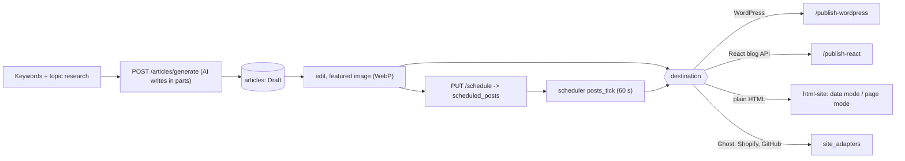

- **Connect a website:** `POST /businesses/{id}/site-integration/detect` reads the technology; `/connect`, `/check`, `DELETE`. React: `/react-site` (configurable base URL, endpoints, auth). HTML sites: `/html-site` (detects how articles are kept, deploys through an adapter). **verify:** `html_site` and the `html-site` router are not in the active router tuple in `main.py` (a commented-out variant of the list includes it); confirm it is enabled where you deploy.
- **Write:** `POST /articles/generate`, `/articles/keywords`, `/{id}/regenerate`, `/{id}/regenerate/sections`, SSE `GET /{id}/stream`; the model is configured by `AI_PROVIDER` and the Ollama/llama.cpp/DeepSeek/OpenAI/Gemini/Claude keys.
- **Publish:** one code path (`article_publishing.py`) for the Publish buttons and the scheduler. Scheduling stores one row in `scheduled_posts` (UTC time, destination, `Draft -> Scheduled -> Publishing -> Published/Failed`); rows are claimed one by one so a post is never sent twice. `PUBLISH_TIMEZONE` and `BLOG_FEATURED_IMAGE_REQUIRED` apply.

**Feeds:** keywords (9), tasks (blog drafts need approval), backlinks and AEO (content strategy).

---

## 13. AI agents, copilot, assistant, work plan, automation pipeline

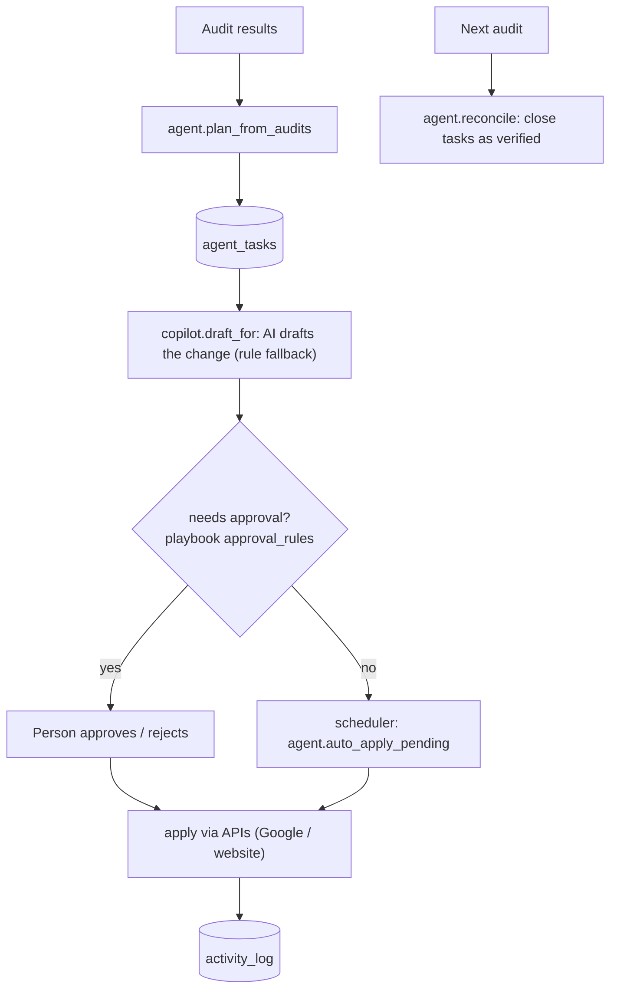

- **Agent** (`services/agent.py`, `routers/agent.py`): tasks `GET /tasks`, `/tasks/counts`, `POST /businesses/{id}/tasks`, `/tasks/{id}/approve|reject|redraft`, `/tasks/approve-low-risk`, `/tasks/bulk`, `/tasks/triage`. Nothing reaches Google or the website without passing `needs_approval`. `ALWAYS_ASK = {profile_edit}`.
- **Playbook** (`services/playbook.py`, `GET/PUT /playbook`, one row): tone, languages, `approval_rules` (defaults: high-star review replies and GBP posts auto; low-star replies, profile edits, website fixes, blog drafts, outreach need a person), `plan_schedules` per plan.
- **Copilot** (`services/copilot.py`, `routers/copilot.py`): daily briefing across the user's projects (cached per set of projects), alerts, audit summary, page rewrites, report text. Every feature has a rules version, so it works without an AI key.
- **Assistant** (`services/assistant.py`, `POST /businesses/{id}/assistant`, `/actions`, `GET /suggestions`): answers questions about ONE project from its own records and links to the page to open.
- **Work plan** (`services/workplan.py`, `routers/workplan.py`): each Monday-Sunday a project gets items from audit fixes, site research, the plan's recurring operations and manual items; unfinished items carry over; items the next audit no longer reports are closed as verified. Endpoints: `/businesses/{id}/workplan`, `/workplan/generate`, items CRUD, `/research`, `/workplan/overview`. Site research (`services/site_research.py`) refreshes monthly.
- **Automation pipeline** (`services/pipeline.py`, `intake.py`, `routers/intake.py`): an onboarding email goes through `extract -> profile -> gbp_match -> audits -> plan -> report -> schedule -> notify`. If details are missing the AI asks the sender (`needs_info`). The mailbox is polled over IMAP each tick (`INTAKE_IMAP_*`, `INTAKE_ALLOWED_SENDERS`); `POST /intake/webhook` is the push alternative; `POST /intake/poll` is admin only.
- **Activity log** (`services/activity.py`, `GET /activity`): every action by a person or an agent.

**Feeds:** GMB writes (6), website fixes, reports (14).

---

## 14. Reports, leads, tasks

- **Reports** (`services/reports.py`, `workplan` report endpoints): monthly client report with numbers vs last month, audit scores, top fixes and a plain-words summary. `GET /businesses/{id}/report`, `.csv`, `.pdf`; weekly `GET /businesses/{id}/reports/history|{period}|{period}/pdf` (`weekly_reports`). The `report` job emails it (`services/notify.py`, SMTP optional). Dashboard "Reports" and `ReportsLeadsPage.jsx`.
- **Leads** (`routers/leads.py`): `GET/POST /businesses/{id}/leads`, `PATCH /leads/{id}`; `GET /insights` (GBP performance, gated, section 7). Weekly growth charts come from `GET /businesses/analytics` (`services/analytics.py`), scoped to the user's projects.
- **Dashboard** (`GET /businesses/portfolio`, `SeoOverviewPage.jsx`): projects, health, agents, schedules, customer actions, attention list.
- **Tasks and activities:** agent tasks (section 13) shown per project and across projects.

---

## 15. Background scheduler and jobs

`services/scheduler.py` (one instance only; a Postgres advisory lock prevents two processes running jobs at once).

| Job | Interval | What it does |
|---|---|---|
| `tick` | `SCHEDULER_TICK_SECONDS` (300 s) | recover stale runs, prune old data (`AUDIT_RETENTION_DAYS` 180), poll the IMAP mailbox, run the onboarding pipeline for waiting emails, back-fill schedule rows, run due schedules (`schedules.run_due`, max 20), publish due blog posts, auto-apply autopilot tasks |
| `posts_tick` | `SCHEDULED_POSTS_TICK_SECONDS` (60 s) | publish blog posts scheduled in the platform |
| `bot_tick` | 60 s, only if `BACKLINK_BOT_AUTO_ENABLED` | backlink rotation or due bots, measure due outcomes, weekly competitor watch |
| `SCHEDULER_ENABLED=false` | | turns the scheduler off |

Per-project schedule rows (`schedules`, one per job; `schedules.JOBS`):

| Job | Runs | Belongs to service |
|---|---|---|
| `full_audit` | all six audits then the agent plan | SEO |
| `rank_scan` | local rank scan + organic positions if Serper is set | SEO |
| `technical` | technical (PageSpeed) audit | SEO |
| `report` | monthly report email | SEO |
| `weekly_plan` | work plan cycle (default weekly) | SEO |
| `site_research` | website research (default monthly) | SEO |
| `site_crawl` | on-page audit from the Site Audit settings | SEO |
| `reviews` | GBP sync (if linked) + draft review replies | GMB |
| `posts` | draft the weekly Google post | GMB |
| `geo` | ask AI engines the tracked prompts | GEO / AEO |

Frequencies per plan come from the playbook (`DEFAULT_PLAN_SCHEDULES`): Starter = monthly audit/report, daily reviews, weekly posts; Growth adds weekly rank scan and technical; Pro and Agency add weekly GEO. A failed job stores `last_error` and logs `job_failed`. Paused projects and removed services are skipped.

---

## 16. Data model

```mermaid
erDiagram
  users ||--o{ businesses : "owner_id (text id)"
  businesses ||--o{ business_managers : has
  google_connections ||--o{ businesses : "connection_id"
  businesses ||--o{ audits : has
  businesses ||--o{ competitors : has
  competitors ||--o{ audits : "competitor_id"
  businesses ||--o{ keywords : has
  businesses ||--o{ rank_scans : has
  businesses ||--o{ keyword_rank_log : has
  businesses ||--o{ geo_prompts : has
  geo_prompts ||--o{ geo_results : has
  businesses ||--o{ reviews : has
  businesses ||--o{ posts : has
  businesses ||--o{ insight_days : has
  businesses ||--o{ leads : has
  businesses ||--o{ articles : has
  articles ||--o{ scheduled_posts : has
  businesses ||--|| site_integrations : has
  businesses ||--|| react_site_connections : has
  businesses ||--|| site_profiles : has
  businesses ||--o{ schedules : has
  businesses ||--o{ agent_tasks : has
  businesses ||--o{ work_items : has
  businesses ||--o{ weekly_reports : has
  businesses ||--o{ activity_log : has
  businesses ||--o{ bi_tracked_targets : has
  bi_domains ||--o{ backlinks : has
  businesses ||--o{ backlinks : "business_id"
  businesses ||--o{ watch_pages : has
```

Notes: `audits.workspace_id` is the project a website scan ran from and has no foreign key; the live database cascades or sets null on every foreign key to `businesses`. `lighthouse_*` tables, `domain_intel_cache` and the `bl_*` backlink-service tables are keyed by URL/domain, not project. `intake_emails.business_id` is `SET NULL`. `playbook` is a single shared row.

Key columns of `businesses` that tie processes together: `owner_id`, `connection_id`, `gbp_account/gbp_location/place_id`, `website`, `plan`, `modules`, `audit_config`, `track_config`, `social_accounts`, `target_scope/target_countries/target_areas`, `last_audit_score`, `status`.

---

## 17. End-to-end journeys

### New client, from sign-in to first report

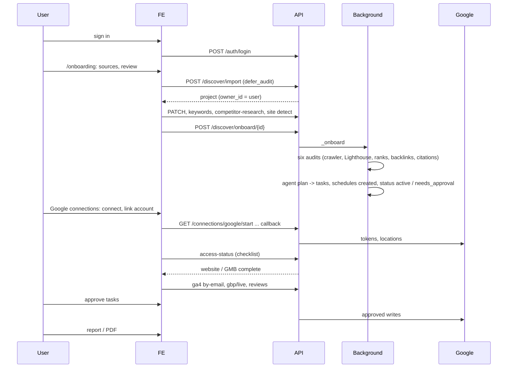

### Daily automated cycle

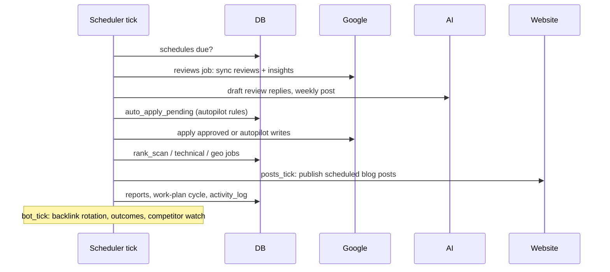

---

## 18. Interlinking matrix

| Producer | Consumer | Through |
|---|---|---|
| Onboarding | audits, schedules, backlinks, work plan | `businesses` row, `schedules`, `bi_tracked_targets`, `/discover/onboard` |
| Google connection | GMB, traffic, Domain Overview | `google_connections`, `businesses.connection_id`, access checklist |
| GBP sync | reviews, insights, profile score, agent | `reviews`, `insight_days`, `businesses.gbp_status` |
| Audits | agent tasks, work plan, dashboard health, reports | `audits`, `agent_tasks`, `work_items`, `businesses.last_audit_score` |
| Keywords | rank scans, organic positions, content, keyword gap | `keywords`, `rank_scans`, `keyword_rank_log` |
| Competitors | research, watch, gap, backlink targets | `competitors`, `bi_tracked_targets`, `watch_*` |
| Backlink bot | backlink audit, intel pages, outreach tasks | `backlinks`, `backlink_*`, `bi_*` |
| GEO prompts | AEO / GEO pages, reports | `geo_prompts`, `geo_results` |
| Articles | website publishing, calendar | `articles`, `scheduled_posts`, `site_integrations`, `react_site_connections` |
| Agent tasks | GBP writes, website fixes, outcome tracking | `agent_tasks`, `action_outcomes`, `activity_log` |
| Modules (Projects page) | scheduler, data deletion | `businesses.modules`, `project_services.job_enabled` |
| Ownership | every project endpoint | `owner_id`, `business_managers`, `deps.py` |
| Two-step code | every project endpoint | `seo_project` cookie, `owned_business` |
| Access checklist | traffic and GBP data endpoints | `access.require` |

---

## 19. Operations

**Ports:** frontend dev server `3100`, backend `8000` (the frontend reads `VITE_API_URL=http://localhost:8000/api/v1`). The root README mentions 8100 in places; use the port your `.env` and `VITE_API_URL` agree on. API docs at `/docs`.

**Run locally**
```
cd backend
.venv\Scripts\python.exe -m uvicorn app.main:app --host 127.0.0.1 --port 8000 --reload
cd frontend
npm install
npm run dev
```
Only one backend may hold port 8000 (two `--reload` servers on one port both hang).

**Configuration keys** (names only, `backend/.env`; defaults in `backend/app/config.py`): `SECRET_KEY`, `ADMIN_EMAIL`, `ADMIN_PASSWORD`, `DATABASE_URL`, `CORS_ORIGINS`, `FRONTEND_URL`, `PUBLIC_BASE_URL`, `COOKIE_SECURE`, `TOKEN_ENCRYPTION_KEY`, `GOOGLE_CLIENT_ID`, `GOOGLE_CLIENT_SECRET`, `GOOGLE_PLACES_API_KEY`, `PAGESPEED_API_KEY`, `GOOGLE_ADS_*`, `SERPER_API_KEY`, `AI_PROVIDER` with `DEEPSEEK_API_KEY`, `OPENAI_API_KEY`, `GEMINI_API_KEY`, `ANTHROPIC_API_KEY`, `PERPLEXITY_API_KEY`, `OLLAMA_*`, `LLAMACPP_*`, `INTAKE_IMAP_*`, `INTAKE_ALLOWED_SENDERS`, `INTAKE_WEBHOOK_TOKEN`, `SMTP_*`, `WORDPRESS_URL/USER/APP_PASSWORD`, `CRM_JWT_SECRET`, `CRM_API_URL`, `CRM_SESSION_COOKIE`, `SCHEDULER_ENABLED`, `SCHEDULER_TICK_SECONDS`, `BACKLINK_*`, `LIGHTHOUSE_*`, `LOGIN_MAX_FAILURES`, `LOGIN_LOCKOUT_MINUTES`, `SCHEMA_AUTO_SYNC`, `AUDIT_RETENTION_DAYS`. Never commit values.

**Database:** SQLite file `backend/seo_platform_dev.db` by default; PostgreSQL in real use.
- **Schema auto-sync** (`services/schema.py`, `SCHEMA_AUTO_SYNC=true`): at start-up it creates missing tables and adds missing columns as nullable ones. It never drops, renames or retypes. A fingerprint file `backend/.schema_ok` skips the check when the models did not change. This is how new columns (`owner_id`, `modules`, `social_accounts`, `totp_*`) appear after a restart.
- **Migrations:** `backend/migrations` (Alembic, `alembic upgrade head`). The live database was not built from this repo's migrations, which is why auto-sync exists; changes that rename or retype stay migrations.

**Tests:** `cd backend && .venv\Scripts\python.exe -m pytest -q tests -p no:cacheprovider`. Known pre-existing failures: `test_site_audit_crawler_walks_a_site_and_scores_it`, `test_google_suggestions_session_and_cached_details`, and `test_rank_scan_and_keywords` at the time of writing; `tests/test_html_sftp.py` needs `paramiko`. Frontend: `cd frontend && npx vite build`.

**Known limitations**
- Two-step code is enforced by the server only for users who turned it on; CRM sessions cannot enrol.
- The backlink service endpoints (`/backlinks`, `/crawl`, `/seeds`) are a shared domain store with no project scoping.
- Lighthouse rows and unprocessed intake emails have no owner column (scoped by host / admin only).
- One-off competitor audits with no project are readable by id by any signed-in user; `competitor_compare` itself does not check ownership (the routers do).
- A second user connecting the same Google email takes over that connection.
- Meta Business Suite is link-by-URL only (no login, no data).
- GEO/AEO split is by engine, not by two separate datasets.
- Scheduler and bot run inside the web process: a restart kills running work (recovered at the next start).
